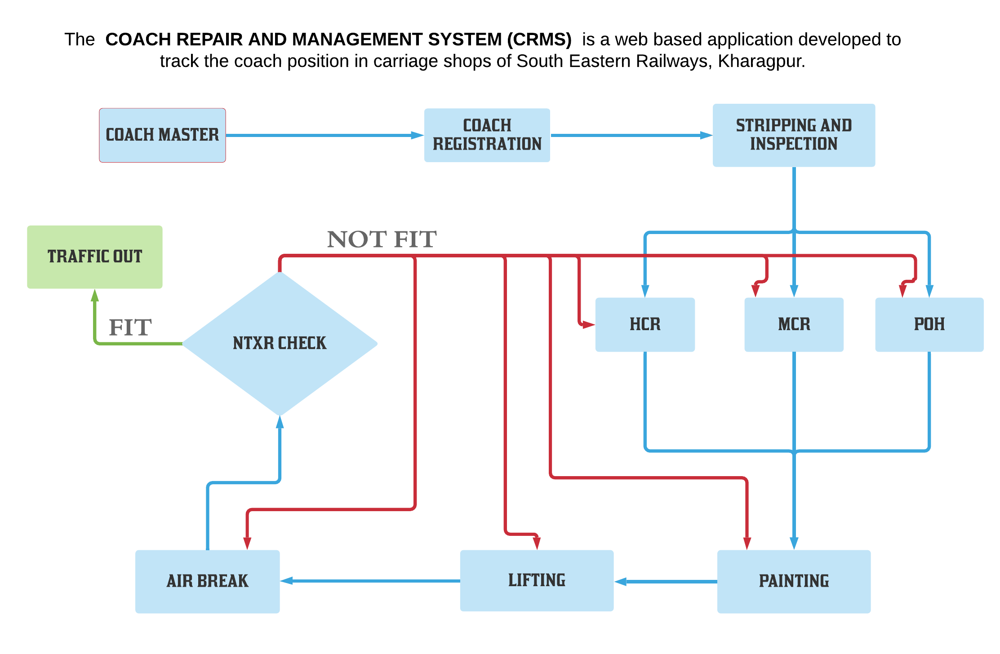

# CRMS v2 — Coach Repair & Management System

**South Eastern Railway Workshop, Kharagpur**

A full rewrite of the original plain PHP/MySQL application as a modern,
responsive, secure web app: **Express + SQLite REST API** with a
**React + Vite + Tailwind CSS** single-page frontend.



## Features

| Section | What it does |
|---|---|
| **Auth** | Login, self-registration (viewer role), JWT in httpOnly cookie, bcrypt passwords |
| **Dashboard** | Live counters: coaches in master / in workshop / released, stage-wise breakdown |
| **Coach Management** | Searchable master list; admins add / edit / delete coaches |
| **Registration** | Register an idle coach for repair (POH / MCR / HCR) with workshop-in date and estimated hours |
| **Maintenance** | Kanban board of the shop floor; admins move coach cards forward/back through the workshop |
| **Reports** | Shop-holding report by stage + full per-coach repair history with printable view |
| **Users** | Admin-only: add, delete, promote/demote users; search |

### The workshop flow

```
Registered → Stripping & Inspection → [POH | MCR | HCR] → Paint → Lifting
   → Brake → Pit Line (NTXR inspection)
        ├─ Fit  → Traffic Out (released)
        └─ Not fit → Repair Shop
                        ├─ repairs ongoing → back to Pit Line
                        └─ done → Traffic Out
```

Every move is validated by a single state machine
(`server/src/services/shopFlow.js`) and recorded as an append-only
timeline in `stage_events` — the 8 scattered per-shop tables of the
legacy app were replaced by this one model.

## Quick start

Requirements: **Node.js ≥ 18** (tested on 22).

```bash
npm install            # root tooling (concurrently)
npm run setup          # install server+client deps, seed the legacy data
npm run dev            # API on :3001 + web app on :5173
```

Open **http://localhost:5173**.

Production-style run (API serves the built SPA from `client/dist`):

```bash
npm run build
npm start              # everything on http://localhost:3001
```

### Demo logins

| Role | Username | Password |
|---|---|---|
| Admin | `jasai007` | `jasai` |
| Viewer | `monty99` | `monty` |

All other users imported from the legacy database have password
`password` (their original MD5 hashes cannot be upgraded to bcrypt
without the plaintext).

### Smoke test

With the server running:

```bash
npm run smoke          # 29 end-to-end API assertions
```

## Project layout

```
├── server/                 Express + better-sqlite3 REST API
│   ├── src/
│   │   ├── index.js        App entry; also serves client/dist in production
│   │   ├── db.js           SQLite schema (users, coaches, registrations, stage_events)
│   │   ├── seed.js         Ports legacy/database/railcoaches.sql into the new schema
│   │   ├── middleware/     JWT auth, requireAuth / requireAdmin guards
│   │   ├── routes/         auth, users, coaches, registrations, reports
│   │   └── services/
│   │       └── shopFlow.js The workshop state machine (replaces 7 check_*.php files)
│   └── scripts/smokeTest.mjs
├── client/                 React + Vite + Tailwind SPA
│   └── src/
│       ├── pages/          Login, Register, Dashboard, Coaches, Registrations,
│       │                   Maintenance (kanban), Reports, Users
│       ├── components/     Layout (responsive sidebar), Modal, StageBadge…
│       ├── context/        AuthContext (session state)
│       └── api/client.js   Fetch wrapper
└── legacy/                 The original PHP application (reference only, not served)
```

## API overview

All endpoints are under `/api`; auth uses an httpOnly cookie.

| Method & path | Access | Purpose |
|---|---|---|
| `POST /auth/login` · `/auth/register` · `/auth/logout`, `GET /auth/me` | public / session | Session handling |
| `GET /coaches?q=` | any user | List/search coach master |
| `POST /coaches`, `PUT/DELETE /coaches/:id` | admin | Manage coaches |
| `GET /registrations?status=&stage=&q=` | any user | List registrations with stage + required move inputs |
| `GET /registrations/:id` | any user | Registration detail + event timeline |
| `POST /registrations` | admin | Register a coach for repair |
| `POST /registrations/:id/move` | admin | `{direction, actualHours?, shopNo?, fit?, done?}` |
| `GET/POST /users`, `PUT /users/:id/role`, `DELETE /users/:id` | admin | User management |
| `GET /reports/stats` · `/reports/holding?stage=` · `/reports/history/:coachNo` | any user | Dashboard + reports |

## Security changes vs v1

- **SQL injection**: eliminated — every query is parameterized (`better-sqlite3`)
- **Passwords**: bcrypt hashes replace MD5; hashes are never returned by the API
- **Sessions**: signed JWT in an httpOnly cookie instead of PHP sessions with plaintext checks
- **Roles**: enforced server-side (`requireAdmin`) on every mutating route, not just hidden in the UI
- **Validation**: zod schemas on every request body
- **No secrets in code**: `JWT_SECRET` read from environment (dev default otherwise)

## Migrating to MySQL

The data layer is isolated in `server/src/db.js`. Swap `better-sqlite3`
for `mysql2/promise`, keep the same table shapes (see the schema there),
and re-point `seed.js` — no route or UI changes required.

## History

v1 (2019–2020) was the original learning project in plain PHP/MySQL and
lives in `legacy/` for reference. See the git history for the original code.
